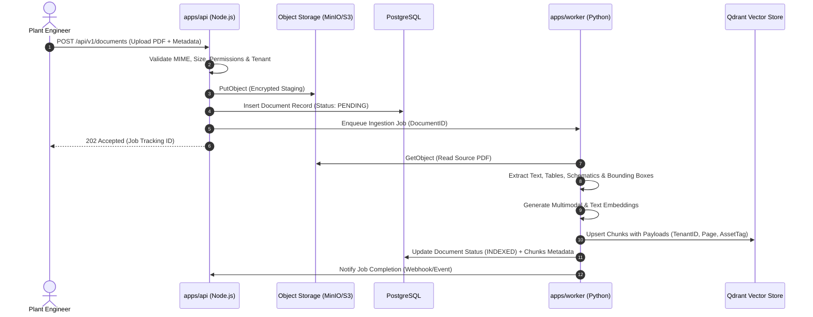
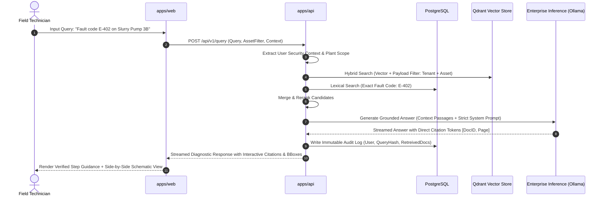

# ForgeX AI — System Architecture Specification

## 1. System Overview & Monorepo Architecture

ForgeX AI is architected as an industrial-grade, modular monorepo. It isolates frontline client interaction, core business logic, high-throughput asynchronous document processing, and persistent state stores while sharing strict TypeScript contracts across tiers.

```
                           +---------------------------------------+
                           |       Field / Plant Operator          |
                           |   (Desktop, Rugged Tablet, Mobile)    |
                           +-------------------+-------------------+
                                               |
                                     HTTPS / WSS (TLS 1.3)
                                               |
+----------------------------------------------v-----------------------------------------------+
| FRONTEND LAYER: apps/web                                                                     |
| - React 18 / Vite / TypeScript / Tailwind CSS                                                |
| - Industrial UI Shell (Graphite Design System, Telemetry Rail, SOP Step Engine)              |
| - PDF & Visual Schematic Canvas Viewer (BBox Annotation & Deep Zoom)                         |
+----------------------------------------------+-----------------------------------------------+
                                               |
                                        REST / WebSocket
                                               |
+----------------------------------------------v-----------------------------------------------+
| BACKEND API GATEWAY & ORCHESTRATION: apps/api                                                |
| - Node.js / Express / TypeScript (Strict ESM, Zod Schema Validation)                         |
| - Security & Auth: JWT / OAuth2 / RBAC Guard / Tenant Scoping                                |
| - Query Orchestrator: Hybrid Vector + Lexical Search Coordinator                             |
| - Pluggable Storage & Model Provider Adapters                                                |
+----------------------+-----------------------+-----------------------+-----------------------+
                       |                       |                       |
          Database     |        Vector Ops     |     Object Storage    |    Async Tasks
          (Prisma/SQL) |        (gRPC / HTTP)  |     (S3 SDK API)      |    (PubSub / Queue)
                       |                       |                       |
+----------------------v--+  +-----------------v-+  +------------------v-+  +------------------v-+
| PostgreSQL 16           |  | Qdrant Vector DB  |  | MinIO / S3 Storage |  | Redis / BullMQ     |
| - User & RBAC Entities  |  | - Dense Vectors   |  | - Original PDFs    |  | - Ingestion Queue  |
| - Document Catalog      |  | - Chunk Payloads  |  | - Extracted Visuals|  | - Heavy OCR Jobs   |
| - Asset Hierarchy       |  | - Tenant Filters  |  | - Plant Schematics |  | - Export Tasks     |
| - Immutable Audit Logs  |  | - Payload Indices |  | - Encrypted at Rest|  |                    |
+-------------------------+  +-------------------+  +--------------------+  +---------+----------+
                                                                                      |
                                                                              Worker Jobs
                                                                                      |
+-------------------------------------------------------------------------------------v----------+
| DOCUMENT & MULTIMODAL INGESTION WORKER: apps/worker                                            |
| - Python 3.12+ / PyMuPDF / OpenCV / LayoutParser / Marker                                      |
| - Multimodal Parsing: Hierarchy tree, Warning/Caution detection, Table to Markdown            |
| - Visual Segmentation: Exploded schematics, Wiring diagrams, P&ID visual tokenization          |
+------------------------------------------------------------------------------------------------+
                                               |
                                       Inference Gateway
                                               |
+----------------------------------------------v-----------------------------------------------+
| ENTERPRISE INFERENCE LAYER (Pluggable Provider Interface)                                     |
| - Local / Air-Gapped: Ollama / vLLM (e.g., Llama-3-70B-Instruct, Qwen2.5-VL, BGE-M3 Embeddings) |
| - Cloud / Hybrid (Optional): Azure OpenAI / Google Vertex AI (GovCloud / FedRAMP isolated)   |
+----------------------------------------------------------------------------------------------+
```

---

## 2. Component Boundaries & Responsibilities

### 2.1 Frontend (`apps/web`)
- **Technology**: React, Vite, TypeScript, Tailwind CSS.
- **Role**: High-contrast, tactile industrial workspace interface.
- **Boundaries**:
  - Stateless rendering driven by API responses and JWT session tokens.
  - Zero direct connections to databases, vector stores, or raw S3 buckets.
  - All document downloads and figure rendering happen via signed, short-lived API pre-signed URLs.

### 2.2 Backend Orchestrator (`apps/api`)
- **Technology**: Node.js, Express, TypeScript, Zod.
- **Role**: Primary domain controller, security enforcement point, and RAG coordinator.
- **Key Subsystems**:
  - `Security & Authorization Engine`: Validates tenant boundaries, roles (`SUPER_ADMIN`, `PLANT_ENGINEER`, `TECHNICIAN`, `AUDITOR`), and equipment-level access tags.
  - `Storage Adapter Subsystem`: Abstract interface (`IStorageProvider`) decoupling code from storage vendor (MinIO, AWS S3, Azure Blob, Local Filesystem).
  - `Inference Provider Subsystem`: Abstract interface (`IInferenceProvider`) decoupling prompt execution from model backends (Local Ollama, vLLM, Azure OpenAI).
  - `Health & Diagnostics Service`: Probes PostgreSQL, Qdrant, S3, and Inference Provider readiness with detailed `/healthz` metrics.

### 2.3 Document & Multimodal Worker (`apps/worker`)
- **Technology**: Python 3.12+, FastAPI/Celery/AsyncIO workers.
- **Role**: Asynchronous, compute-heavy document decomposition.
- **Capabilities**:
  - PDF layout decomposition (headers, paragraphs, footers, caution blocks).
  - Table structure extraction into structured JSON and Markdown.
  - Diagram and figure cropping with high-resolution bounding boxes.
  - Document chunk hashing to guarantee idempotent processing.

### 2.4 Shared Contract Layer (`packages/shared-types`)
- **Technology**: TypeScript library compiled for Node.js and Browser runtimes.
- **Role**: Single source of truth for:
  - Domain entities (Documents, Chunks, Assets, Workflows, Audit Events).
  - API Request/Response DTOs.
  - Role definitions and Permission Bitmasks.
  - Error schemas and standardized API envelopes.

---

## 3. Data Flow Pipelines

### 3.1 Ingestion Flow


### 3.2 Grounded Retrieval & Diagnostic Reasoning Flow


---

## 4. Deployment Modes

| Deployment Topology | Target Environment | Inference Engine | Storage & Database | Network Isolation |
| :--- | :--- | :--- | :--- | :--- |
| **Fully Air-Gapped (OT Network)** | Nuclear, defense, chemical refineries, off-grid plants. | Local GPU server running Ollama / vLLM (local weights). | On-prem PostgreSQL, Qdrant cluster, MinIO SAN/NAS. | Zero external Internet access. Strictly contained in Plant Level 3 / DMZ. |
| **Hybrid Enterprise** | Multi-site manufacturing with centralized corporate engineering. | Local plant inference for real-time SOPs; central LLM for cross-plant analytics. | Local edge cache with replicated cloud PostgreSQL & MinIO. | Encrypted VPN / IPsec tunnel between plants and private cloud. |
| **Sovereign Cloud VPC** | Dedicated single-tenant GovCloud / AWS / Azure / GCP. | Private LLM endpoints (e.g. Azure OpenAI on dedicated virtual network). | Managed RDS Postgres, Managed Qdrant Cloud / ECS, S3. | Isolated VPC, PrivateLink endpoints, SOC 2 / FedRAMP boundary. |

---

## 5. Security & Network Boundaries (Purdue Model Alignment)

ForgeX AI aligns with industrial cybersecurity architectures (ANSI/ISA-95 and Purdue Enterprise Reference Architecture):

- **Level 4 / Enterprise Network**: Central management dashboard, administrative document uploads, enterprise identity provider (IdP).
- **Industrial DMZ (Level 3.5)**: ForgeX API Gateway, Qdrant Vector Store, and MinIO storage cluster. Acts as a strict inspection barrier between business systems and industrial operations.
- **Level 3 (Manufacturing Operations & Control)**: Field engineering tablets and control room terminals accessing ForgeX AI over read-only, authenticated TLS 1.3 streams.
- **Level 2 / 1 (Control & Field Devices)**: **Isolated**. ForgeX AI has **zero** outbound control write paths to Level 1 PLCs, RTUs, or actuators.
