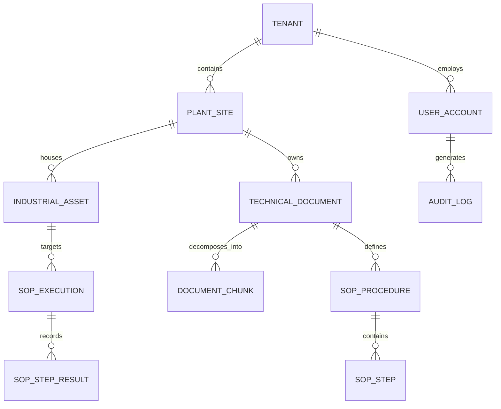

# ForgeX AI — Data Model Specification

## 1. Relational Database Schema (PostgreSQL 16)

ForgeX AI uses PostgreSQL 16 as its system of record for tenancy, identity, document cataloging, asset hierarchies, procedure execution state, and audit events. Migration 033 requires chain fields on new audit inserts, adds a per-organization SHA-256 chain, and triggers that reject ordinary row updates/deletes and table truncation. Events written before migration 033 remain legacy and are not retroactively verified. A database owner/superuser can bypass or alter database controls; the chain is tamper-evident, not an immutable ledger. The API provides a verifier and an opt-in AWS S3 Object Lock Compliance archive command; successful archival depends on a separately administered, correctly configured bucket and credentials.



---

### 1.1 Core Entities & Table Definitions

#### `tenants`
| Column | Type | Constraints | Description |
| :--- | :--- | :--- | :--- |
| `id` | `UUID` | `PRIMARY KEY, DEFAULT gen_random_uuid()` | Unique tenant identifier. |
| `name` | `VARCHAR(255)` | `NOT NULL` | Organization name. |
| `slug` | `VARCHAR(64)` | `UNIQUE, NOT NULL` | URL-safe tenant identifier. |
| `created_at` | `TIMESTAMPTZ` | `DEFAULT NOW()` | Record creation timestamp. |

#### `plant_sites`
| Column | Type | Constraints | Description |
| :--- | :--- | :--- | :--- |
| `id` | `UUID` | `PRIMARY KEY` | Unique site identifier. |
| `tenant_id` | `UUID` | `REFERENCES tenants(id) ON DELETE CASCADE` | Parent tenant boundary. |
| `code` | `VARCHAR(32)` | `NOT NULL` | Facility code (e.g., `PLANT-TX-04`). |
| `name` | `VARCHAR(255)` | `NOT NULL` | Facility full name. |
| `air_gapped_mode` | `BOOLEAN` | `DEFAULT FALSE` | True if facility forbids cloud sync. |

#### `industrial_assets`
| Column | Type | Constraints | Description |
| :--- | :--- | :--- | :--- |
| `id` | `UUID` | `PRIMARY KEY` | Unique asset ID. |
| `tenant_id` | `UUID` | `REFERENCES tenants(id)` | Tenant boundary. |
| `plant_id` | `UUID` | `REFERENCES plant_sites(id)` | Facility location. |
| `asset_tag` | `VARCHAR(64)` | `NOT NULL` | P&ID Tag (e.g., `PUMP-204-B`). |
| `name` | `VARCHAR(255)` | `NOT NULL` | Functional title. |
| `area` | `VARCHAR(128)` | `NOT NULL` | Unit / battery limit area. |
| `manufacturer` | `VARCHAR(128)` | `NOT NULL` | OEM builder (e.g., Flowserve). |
| `model_number` | `VARCHAR(128)` | `NOT NULL` | Model number. |
| `operational_state` | `VARCHAR(32)` | `DEFAULT 'OPTIMAL'` | `OPTIMAL`, `ADVISORY`, `TRIPPED`. |

#### `technical_documents`
| Column | Type | Constraints | Description |
| :--- | :--- | :--- | :--- |
| `id` | `UUID` | `PRIMARY KEY` | Document identifier. |
| `tenant_id` | `UUID` | `REFERENCES tenants(id)` | Tenant isolation boundary. |
| `plant_id` | `UUID` | `REFERENCES plant_sites(id)` | Facility scope. |
| `doc_number` | `VARCHAR(64)` | `NOT NULL` | Official number (e.g., `SOP-MTR-042`). |
| `title` | `TEXT` | `NOT NULL` | Engineering document title. |
| `category` | `VARCHAR(32)` | `NOT NULL` | `SOP`, `OEM_MANUAL`, `SCHEMATIC_PID`. |
| `revision` | `VARCHAR(16)` | `NOT NULL` | Engineering revision code. |
| `storage_key` | `TEXT` | `NOT NULL` | S3 / MinIO object key. |
| `checksum_sha256` | `CHAR(64)` | `NOT NULL` | File-integrity checksum; not an audit-log immutability control. |
| `total_pages` | `INTEGER` | `NOT NULL` | Extracted page count. |
| `status` | `VARCHAR(32)` | `DEFAULT 'PENDING'` | `PENDING`, `PARSING`, `INDEXED`. |

#### `document_chunks`
| Column | Type | Constraints | Description |
| :--- | :--- | :--- | :--- |
| `id` | `UUID` | `PRIMARY KEY` | Chunk identifier. |
| `document_id` | `UUID` | `REFERENCES technical_documents(id)` | Source document. |
| `page_number` | `INTEGER` | `NOT NULL` | Origin page number. |
| `content` | `TEXT` | `NOT NULL` | Cleaned text or markdown table. |
| `bbox_json` | `JSONB` | `NULLABLE` | Normalized bounding box `[x1,y1,x2,y2]`. |
| `is_table` | `BOOLEAN` | `DEFAULT FALSE` | True if extracted from tabular matrix. |
| `is_figure` | `BOOLEAN` | `DEFAULT FALSE` | True if cropped diagram snippet. |
| `qdrant_point_id` | `UUID` | `UNIQUE` | Corresponding vector ID in Qdrant. |

#### `audit_events` (Current Event Log; Integrity Controls Not Yet Implemented)
| Column | Type | Constraints | Description |
| :--- | :--- | :--- | :--- |
| `id` | `UUID` | `PRIMARY KEY, DEFAULT gen_random_uuid()` | Event identifier. |
| `organization_id` | `UUID` | `NOT NULL, REFERENCES organizations(id)` | Organization scope. |
| `actor_user_id` | `UUID` | `REFERENCES users(id)` | Actor when available. |
| `action` | `VARCHAR(64)` | `NOT NULL` | Event action. |
| `resource_type` | `VARCHAR(64)` | `NOT NULL` | Resource kind. |
| `resource_id` | `VARCHAR(64)` | `NOT NULL` | Resource identifier. |
| `metadata` | `JSONB` | `NOT NULL, DEFAULT '{}'` | Event metadata; sensitive data handling must be reviewed per event type. |
| `ip_address` | `VARCHAR(45)` | Nullable | Caller IP when supplied. |
| `user_agent` | `TEXT` | Nullable | Caller user-agent when supplied. |
| `created_at` | `TIMESTAMPTZ` | `NOT NULL, DEFAULT NOW()` | Database timestamp; not independently tamper-proof. |

Migration 033 adds the nullable `chain_sequence`, `previous_hash`, and `event_hash` columns. Rows written before that migration remain unchained. The migration trigger rejects ordinary updates/deletes, but a database owner can bypass it. Independently administered Object Lock archival is opt-in and deployment-configured. SHA-256 document checksums can detect file-content differences when compared to a trusted checksum; they do not prevent an authorized database operator from changing both a record and its checksum.

---

## 2. Multimodal Vector Store Schema (Qdrant)

ForgeX AI utilizes a single high-performance collection partitioned by metadata payload filters.

- **Collection Name**: `forgex_multimodal_chunks`
- **Vector Dimensions**: `1024` (BGE-M3 / Nomic-Embed / Cohere Embed v3)
- **Distance Metric**: `Cosine`
- **HNSW Index Configuration**:
  - `m`: 16
  - `ef_construct`: 128
  - `full_scan_threshold`: 10000

### Payload Structure & Indices
```json
{
  "point_id": "7c9e6679-7425-40de-944b-e07fc1f90ae7",
  "payload": {
    "tenant_id": "c1f7b920-5621-4f11-9a72-bdf47321e012",
    "plant_id": "d80b721e-1901-46bb-88a2-2b6d519b0499",
    "document_id": "a9018420-1120-410a-b328-118809aaee21",
    "doc_number": "SOP-MTR-042",
    "asset_tags": ["PUMP-204-B", "PUMP-LINE-01"],
    "page_number": 14,
    "category": "SOP",
    "is_table": false,
    "is_figure": true,
    "bbox": {
      "x1": 120,
      "y1": 440,
      "x2": 890,
      "y2": 620
    },
    "text_snippet": "Gland follower star-pattern torque: 34 Nm ± 1.5 Nm..."
  }
}
```

**Payload Indexing**:
- Keyword index on: `tenant_id`, `plant_id`, `category`, `asset_tags`
- Integer index on: `page_number`
- Boolean index on: `is_table`, `is_figure`

---

## 3. Asynchronous Queue Schema (Redis 7 & BullMQ)

BullMQ runs over Redis 7 for high-concurrency ingestion and heavy extraction pipelines.

| Queue Name | Producer | Consumer | Payload Contract |
| :--- | :--- | :--- | :--- |
| `forgex:document-ingest` | Backend API (`apps/api`) | Python Worker (`apps/worker`) | `{ documentId: string, storageKey: string, tenantId: string }` |
| `forgex:ocr-extraction` | Python Worker | Python Worker | `{ documentId: string, pageRange: [number, number] }` |
| `forgex:vector-upsert` | Python Worker | Python Worker | `{ documentId: string, chunkBatches: Array<ChunkPayload> }` |
| `forgex:audit-sync` | Backend API | Backend API Worker | `{ auditEvent: AuditLogDTO }` |
