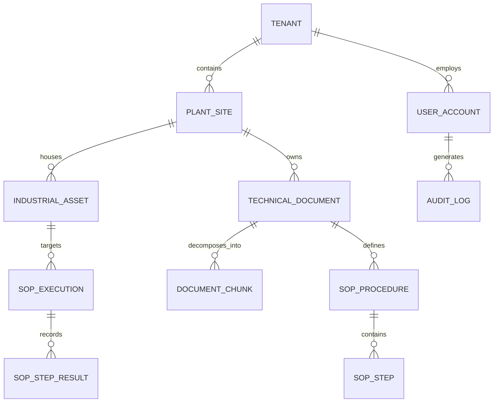

# ForgeX AI — Data Model Specification

## 1. Relational Database Schema (PostgreSQL 16)

ForgeX AI uses PostgreSQL 16 as its system of record for tenancy, identity, document cataloging, asset hierarchies, procedure execution state, and immutable compliance audit logs.



---

### 1.1 Core Entities & Table Definitions

#### `tenants`
| Column | Type | Constraints | Description |
| :--- | :--- | :--- | :--- |
| `id` | `UUID` | `PRIMARY KEY, DEFAULT gen_random_uuid()` | Unique tenant identifier. |
| `name` | `VARCHAR(255)` | `NOT NULL` | Organization name. |
| `slug` | `VARCHAR(64)` | `UNIQUE, NOT NULL` | URL-safe tenant identifier. |
| `created_at` | `TIMESTAMPTZ` | `DEFAULT NOW()` | Record creation timestamp. |

#### `plant_sites`
| Column | Type | Constraints | Description |
| :--- | :--- | :--- | :--- |
| `id` | `UUID` | `PRIMARY KEY` | Unique site identifier. |
| `tenant_id` | `UUID` | `REFERENCES tenants(id) ON DELETE CASCADE` | Parent tenant boundary. |
| `code` | `VARCHAR(32)` | `NOT NULL` | Facility code (e.g., `PLANT-TX-04`). |
| `name` | `VARCHAR(255)` | `NOT NULL` | Facility full name. |
| `air_gapped_mode` | `BOOLEAN` | `DEFAULT FALSE` | True if facility forbids cloud sync. |

#### `industrial_assets`
| Column | Type | Constraints | Description |
| :--- | :--- | :--- | :--- |
| `id` | `UUID` | `PRIMARY KEY` | Unique asset ID. |
| `tenant_id` | `UUID` | `REFERENCES tenants(id)` | Tenant boundary. |
| `plant_id` | `UUID` | `REFERENCES plant_sites(id)` | Facility location. |
| `asset_tag` | `VARCHAR(64)` | `NOT NULL` | P&ID Tag (e.g., `PUMP-204-B`). |
| `name` | `VARCHAR(255)` | `NOT NULL` | Functional title. |
| `area` | `VARCHAR(128)` | `NOT NULL` | Unit / battery limit area. |
| `manufacturer` | `VARCHAR(128)` | `NOT NULL` | OEM builder (e.g., Flowserve). |
| `model_number` | `VARCHAR(128)` | `NOT NULL` | Model number. |
| `operational_state` | `VARCHAR(32)` | `DEFAULT 'OPTIMAL'` | `OPTIMAL`, `ADVISORY`, `TRIPPED`. |

#### `technical_documents`
| Column | Type | Constraints | Description |
| :--- | :--- | :--- | :--- |
| `id` | `UUID` | `PRIMARY KEY` | Document identifier. |
| `tenant_id` | `UUID` | `REFERENCES tenants(id)` | Tenant isolation boundary. |
| `plant_id` | `UUID` | `REFERENCES plant_sites(id)` | Facility scope. |
| `doc_number` | `VARCHAR(64)` | `NOT NULL` | Official number (e.g., `SOP-MTR-042`). |
| `title` | `TEXT` | `NOT NULL` | Engineering document title. |
| `category` | `VARCHAR(32)` | `NOT NULL` | `SOP`, `OEM_MANUAL`, `SCHEMATIC_PID`. |
| `revision` | `VARCHAR(16)` | `NOT NULL` | Engineering revision code. |
| `storage_key` | `TEXT` | `NOT NULL` | S3 / MinIO object key. |
| `checksum_sha256` | `CHAR(64)` | `NOT NULL` | Tamper-prevention file hash. |
| `total_pages` | `INTEGER` | `NOT NULL` | Extracted page count. |
| `status` | `VARCHAR(32)` | `DEFAULT 'PENDING'` | `PENDING`, `PARSING`, `INDEXED`. |

#### `document_chunks`
| Column | Type | Constraints | Description |
| :--- | :--- | :--- | :--- |
| `id` | `UUID` | `PRIMARY KEY` | Chunk identifier. |
| `document_id` | `UUID` | `REFERENCES technical_documents(id)` | Source document. |
| `page_number` | `INTEGER` | `NOT NULL` | Origin page number. |
| `content` | `TEXT` | `NOT NULL` | Cleaned text or markdown table. |
| `bbox_json` | `JSONB` | `NULLABLE` | Normalized bounding box `[x1,y1,x2,y2]`. |
| `is_table` | `BOOLEAN` | `DEFAULT FALSE` | True if extracted from tabular matrix. |
| `is_figure` | `BOOLEAN` | `DEFAULT FALSE` | True if cropped diagram snippet. |
| `qdrant_point_id` | `UUID` | `UNIQUE` | Corresponding vector ID in Qdrant. |

#### `audit_logs` (Append-Only Ledger)
| Column | Type | Constraints | Description |
| :--- | :--- | :--- | :--- |
| `id` | `BIGSERIAL` | `PRIMARY KEY` | Monotonically increasing sequential ID. |
| `tenant_id` | `UUID` | `NOT NULL` | Tenant boundary. |
| `actor_id` | `UUID` | `NOT NULL` | User identifier. |
| `actor_role` | `VARCHAR(32)` | `NOT NULL` | Role active during operation. |
| `action` | `VARCHAR(64)` | `NOT NULL` | `DIAGNOSTIC_QUERY`, `LOTO_SIGNOFF`, etc. |
| `asset_tag` | `VARCHAR(64)` | `NULLABLE` | Associated asset tag. |
| `citations` | `JSONB` | `NOT NULL` | Document IDs, pages & coordinates returned. |
| `request_hash` | `CHAR(64)` | `NOT NULL` | SHA-256 hash of query & context. |
| `timestamp` | `TIMESTAMPTZ` | `DEFAULT NOW()` | Immutable UTC timestamp. |

---

## 2. Multimodal Vector Store Schema (Qdrant)

ForgeX AI utilizes a single high-performance collection partitioned by metadata payload filters.

- **Collection Name**: `forgex_multimodal_chunks`
- **Vector Dimensions**: `1024` (BGE-M3 / Nomic-Embed / Cohere Embed v3)
- **Distance Metric**: `Cosine`
- **HNSW Index Configuration**:
  - `m`: 16
  - `ef_construct`: 128
  - `full_scan_threshold`: 10000

### Payload Structure & Indices
```json
{
  "point_id": "7c9e6679-7425-40de-944b-e07fc1f90ae7",
  "payload": {
    "tenant_id": "c1f7b920-5621-4f11-9a72-bdf47321e012",
    "plant_id": "d80b721e-1901-46bb-88a2-2b6d519b0499",
    "document_id": "a9018420-1120-410a-b328-118809aaee21",
    "doc_number": "SOP-MTR-042",
    "asset_tags": ["PUMP-204-B", "PUMP-LINE-01"],
    "page_number": 14,
    "category": "SOP",
    "is_table": false,
    "is_figure": true,
    "bbox": {
      "x1": 120,
      "y1": 440,
      "x2": 890,
      "y2": 620
    },
    "text_snippet": "Gland follower star-pattern torque: 34 Nm ± 1.5 Nm..."
  }
}
```

**Payload Indexing**:
- Keyword index on: `tenant_id`, `plant_id`, `category`, `asset_tags`
- Integer index on: `page_number`
- Boolean index on: `is_table`, `is_figure`

---

## 3. Asynchronous Queue Schema (Redis 7 & BullMQ)

BullMQ runs over Redis 7 for high-concurrency ingestion and heavy extraction pipelines.

| Queue Name | Producer | Consumer | Payload Contract |
| :--- | :--- | :--- | :--- |
| `forgex:document-ingest` | Backend API (`apps/api`) | Python Worker (`apps/worker`) | `{ documentId: string, storageKey: string, tenantId: string }` |
| `forgex:ocr-extraction` | Python Worker | Python Worker | `{ documentId: string, pageRange: [number, number] }` |
| `forgex:vector-upsert` | Python Worker | Python Worker | `{ documentId: string, chunkBatches: Array<ChunkPayload> }` |
| `forgex:audit-sync` | Backend API | Backend API Worker | `{ auditEvent: AuditLogDTO }` |
