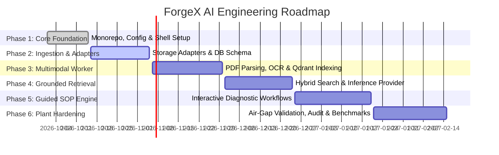

# ForgeX AI — Phased Implementation Plan

## 1. Roadmap Overview & Phased Deliverables

The development of ForgeX AI is structured into six discrete, reviewable engineering phases. Each phase establishes hardened, production-grade components with verifiable acceptance criteria.

---

## 2. Phase Breakdown & Acceptance Criteria

### Phase 1: Greenfield Engineering Foundation (Current Phase)
- **Goal**: Deliver a reproducible monorepo layout, shared contracts, environment validation, structured logging, backend health check, and a tactile industrial UI shell.
- **Key Modules**:
  1. Monorepo structure (`apps/web`, `apps/api`, `apps/worker`, `packages/shared-types`).
  2. Core documentation suite (`PRODUCT_SPEC.md`, `ARCHITECTURE.md`, `IMPLEMENTATION_PLAN.md`, `SECURITY.md`).
  3. Strict TypeScript configuration, linting, formatting, and unit test harness.
  4. Node.js backend with Zod configuration validation, structured Pino logging, and deep `/healthz` endpoints.
  5. React industrial engineering workspace UI shell with Graphite design tokens, asset/plant switcher, telemetry status rail, and SOP navigation layout.
  6. Docker Compose environment for PostgreSQL, Qdrant, MinIO, and Ollama.
- **Acceptance Criteria**:
  - `npm run build` succeeds across all workspaces without type errors.
  - `npm test` executes unit tests with 100% pass rate.
  - Backend starts cleanly, validates `.env` variables, and responds to `GET /healthz` with HTTP 200.
  - Frontend launches and renders the responsive industrial workspace shell with no console errors.

---

### Phase 2: Secure Document Ingestion & Storage Adapters
- **Goal**: Build tenant-isolated document upload, metadata cataloging, and pluggable storage integration.
- **Key Modules**:
  1. PostgreSQL relational schema (Tenants, Users, Roles, Documents, DocumentRevisions, PlantAssets).
  2. S3/MinIO pluggable storage adapter with checksum validation and signed download URLs.
  3. File quarantine and anti-malware pipeline hook.
  4. Document ingestion API with chunked multi-part upload support.
- **Acceptance Criteria**:
  - Validated uploads to MinIO with SHA-256 integrity verification.
  - RBAC policy blocks unauthorized tenant cross-access at database level.
  - Automated integration tests cover upload, download, and deletion cycles.

---

### Phase 3: Multimodal Processing & Vector Indexing Worker
- **Goal**: Implement Python-based layout extraction, table vectorization, diagram segmentation, and Qdrant indexing.
- **Key Modules**:
  1. Python worker queue consumer (BullMQ/Redis or Celery).
  2. OCR & layout analysis engine extracting headers, paragraph bounding boxes, and warning callouts.
  3. Visual schematic cropper generating web-optimized WebP diagram snippets.
  4. Qdrant vector collection setup with dense embeddings (BGE-M3 or nomic-embed-text) and payload filtering.
- **Acceptance Criteria**:
  - 100-page complex industrial PDF parsed in `< 45 seconds`.
  - Figures and tables extracted with exact bounding-box coordinates.
  - Vectors successfully inserted into Qdrant with tenant and asset metadata payloads.

---

### Phase 4: Grounded Retrieval & Enterprise Inference
- **Goal**: Implement hybrid vector-lexical retrieval, reranking, and pluggable enterprise LLM inference.
- **Key Modules**:
  1. Hybrid retrieval pipeline combining Qdrant dense vector search with PostgreSQL Full-Text Search.
  2. Reciprocal Rank Fusion (RRF) and Cross-Encoder reranking.
  3. Pluggable `IInferenceProvider` supporting local Ollama (`qwen2.5`, `llama3.3`) and Azure OpenAI.
  4. Grounding engine enforcing strict citation tokens and rejecting out-of-context queries.
- **Acceptance Criteria**:
  - Diagnostic query returns citations with exact document ID, page, and bounding box.
  - Queries with missing documentation return verified "Not found in authorized manuals" signal.
  - End-to-end query latency `< 2.5s` on local Ollama GPU node.

---

### Phase 5: Guided Troubleshooting & Interactive SOP Workflows
- **Goal**: Deliver step-by-step interactive SOP execution with safety checkpoints and visual verification.
- **Key Modules**:
  1. SOP state machine (Not Started, Safety Check In-Progress, Active, Blocked/Deviation, Completed).
  2. LOTO and PPE mandatory confirmation gate.
  3. Real-time visual comparison of technician uploaded photo against OEM diagram.
  4. Deviation logging with supervisor escalation triggers.
- **Acceptance Criteria**:
  - Technician cannot advance past Step 1 without signing off on Lockout/Tagout.
  - Out-of-tolerance sensor/measurement entries automatically trigger safety escalation.
  - Complete procedure execution produces an exportable, tamper-evident audit report.

---

### Phase 6: Plant Hardening, Air-Gap Validation & Operational Auditing
- **Goal**: Finalize air-gapped container packaging, performance stress testing, and compliance verification.
- **Key Modules**:
  1. Air-gapped offline Docker image bundle creation and offline model weight loading.
  2. High-concurrency load testing (50 concurrent technician queries).
  3. NIST 800-82 and OSHA compliance verification audit report.
  4. Backup, restore, and disaster recovery automated scripts.
- **Acceptance Criteria**:
  - Zero external outbound network packets during full end-to-end operation in air-gapped test rig.
  - Load test verifies P95 response latency `< 2.8s` under 50 concurrent streams.
  - Complete penetration test confirms zero unauthorized document leaks.

---

## 3. Parallel Workstreams & Team Ownership

| Workstream | Lead Discipline | Primary Responsibilities |
| :--- | :--- | :--- |
| **Stream A: UI/UX & Frontline App** | Frontend Engineer | React industrial workspace, PDF canvas zoom/bounding boxes, SOP state engine, responsive tablet UX. |
| **Stream B: API Gateway & Security** | Backend/Platform Engineer | Express gateway, PostgreSQL schema, JWT/RBAC middleware, storage adapters, audit logging. |
| **Stream C: Document & Multimodal AI** | AI/ML Pipeline Engineer | Python ingestion worker, layout-aware OCR, Qdrant vector indexing, Ollama inference integration. |
| **Stream D: Industrial SecOps & Infra** | DevOps / OT Specialist | Docker Compose, air-gap packaging, Purdue model network rules, performance benchmarks. |
