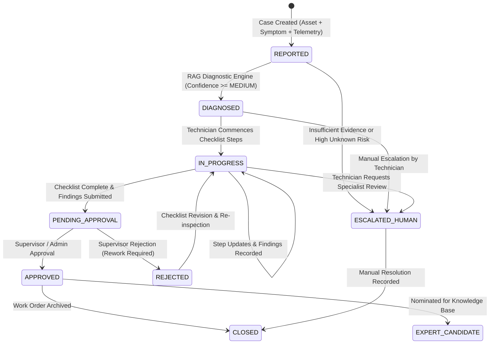

# ForgeX AI — Phase 6: Controlled Evidence-to-Action Maintenance Workflows

## 1. Overview & Architectural Principles

Phase 6 extends ForgeX AI into an auditable, controlled industrial troubleshooting and maintenance workspace. Operating in high-reliability chemical, manufacturing, and energy domains requires that generative AI is **never** granted autonomous mechanical authority and **never** substitutes for approved operating procedures or certified technicians.

Instead, ForgeX AI implements a deterministic **Evidence-to-Action** architecture:
1. **Asset-Linked Case Intake**: Captures physical asset context, operating conditions, symptoms, and field photography.
2. **Deterministic Document Retrieval**: Scans authorized technical manuals, OEM specifications, and plant SOPs using the existing Phase 4/5 RAG engine and tenant-scoped security filters.
3. **Cited Diagnostic Hypotheses**: Produces structured hypotheses with explicit confidence scores, root causes, missing information, and safety-critical directives.
4. **Verifiable Guided Checklists**: Derives step-by-step troubleshooting actions where every action links to an exact page, chunk, and revision citation.
5. **Human-in-the-Loop Execution & Approval**: Technicians record physical measurements, findings, and observations. Work orders undergo formal review by authorized engineering supervisors.
6. **Automatic Escalation**: Any ambiguous symptom, missing SOP evidence, or high-risk unknown condition escalates directly to a qualified human engineer rather than fabricating speculative instructions.
7. **Expert Knowledge Pipeline**: High-quality, supervisor-approved resolutions can be nominated into institutional expert knowledge with tenant feedback metrics.

---

## 2. Maintenance Case State Machine



### State Definitions
- **`REPORTED`**: Case initialized with machine telemetry, symptoms, and optional photos. Awaiting AI diagnosis or manual triage.
- **`DIAGNOSED`**: AI RAG engine has retrieved matching SOP passages, formulated hypotheses, and generated an evidence-linked checklist.
- **`IN_PROGRESS`**: Technician has engaged the checklist, performing LOTO checks, component inspections, and recording measurements.
- **`PENDING_APPROVAL`**: Technician has finalized observations and resolution summary, formally submitting the work order for review.
- **`APPROVED`**: Qualified engineer or administrator has verified the work order, findings, and torque/leak-off criteria.
- **`REJECTED`**: Supervisor rejected work order due to incomplete criteria or out-of-spec readings; returned to technician for remediation.
- **`ESCALATED_HUMAN`**: Escalated to senior plant reliability engineer due to insufficient document coverage, high uncertainty, or safety hazards.
- **`CLOSED`**: Lifecycle complete, historical audit trail preserved.

---

## 3. Safety-Critical Governance & Guardrails

### 3.1 Non-Negotiable Safety Invariants
1. **No Autonomous Operation**: ForgeX AI will never issue SCADA/PLC commands or manipulate control valves, breakers, or interlocks.
2. **Lockout/Tagout (LOTO) Primacy**: Every checklist step involving fluid depressurization, mechanical disassembly, or electrical contact mandates Zero Energy State verification before fastener manipulation.
3. **Model Confidence as Signal**: Confidence levels (`HIGH`, `MEDIUM`, `UNCERTAIN`, `INSUFFICIENT_EVIDENCE`) are treated as operational signals, never as verification that a diagnosis is correct.
4. **Zero Speculation Guarantee**: If a symptom (e.g. unexpected chemical fouling) does not match authorized plant SOPs, the engine halts automated checklist generation and triggers `ESCALATED_HUMAN`.

### 3.2 Authorization & RBAC Matrix
| Action | Organization Admin | Engineer / Technician | Viewer |
| :--- | :---: | :---: | :---: |
| Create Case | Yes | Yes | No |
| Run AI Diagnosis | Yes | Yes | No |
| Update Checklist Steps | Yes | Yes | No |
| Submit Work Order Findings | Yes | Yes | No |
| Approve / Reject Work Order | **Yes** | **Yes (Authorized Lead)** | **No (403 Forbidden)** |
| Escalate to Human | Yes | Yes | No |
| Nominate Expert Knowledge | Yes | Yes | No |
| View Case & Audit History | Yes | Yes | Yes (Read Only) |

---

## 4. API Endpoints

All endpoints are mounted under `/api/v1/maintenance` and require bearer authentication and tenant scoping:

### 1. `POST /api/v1/maintenance/cases`
Creates a new maintenance case linked to plant, asset, reporting user, and operating telemetry.
```json
{
  "plantId": "PLANT-TX-04",
  "assetId": "asset-p101-a",
  "title": "Centrifugal Pump P-101-A Mechanical Seal Weepage",
  "severity": "HIGH",
  "symptomDescription": "Visible fluid weepage at primary seal follower plate...",
  "operatingConditions": { "suctionPressurePsi": 28, "bearingTempC": 68 },
  "visualAssetIds": ["vis-seal-p101"]
}
```

### 2. `POST /api/v1/maintenance/cases/:id/diagnose`
Invokes the multimodal RAG engine to query authorized plant SOPs, evaluate symptom matches, formulate a structured hypothesis, and generate cited checklist steps.

### 3. `PATCH /api/v1/maintenance/cases/:id/steps/:stepId`
Updates checklist step status (`PENDING`, `IN_PROGRESS`, `COMPLETED`, `SKIPPED`, `BLOCKED`), along with technician notes.

### 4. `POST /api/v1/maintenance/cases/:id/findings`
Submits technician physical observations, measured values (e.g., torque ft-lbs), and resolution summary, transitioning case to `PENDING_APPROVAL`.

### 5. `POST /api/v1/maintenance/cases/:id/approval`
Supervisor review endpoint. Requires `status: "APPROVED"` or `"REJECTED"` and supervisor notes.

### 6. `POST /api/v1/maintenance/cases/:id/escalate`
Immediately escalates case to `ESCALATED_HUMAN` with reason and specialist designation.

### 7. `POST /api/v1/maintenance/cases/:id/feedback`
Records technician rating (`HELPFUL` / `UNHELPFUL`), feedback comments, and `nominateForKnowledgeBase` boolean flag.

---

## 5. Audit Ledger & Compliance Traceability

Every lifecycle transition records two immutable audit artifacts:
1. **`case_history` Table**: Logs the specific action, actor, timestamp, and metadata diff directly linked to the case ID.
2. **`audit_events` Table**: Logs tenant-level regulatory compliance events (`MAINTENANCE_CASE_CREATED`, `MAINTENANCE_WORK_ORDER_APPROVED`, `MAINTENANCE_ESCALATED_TO_HUMAN`).
